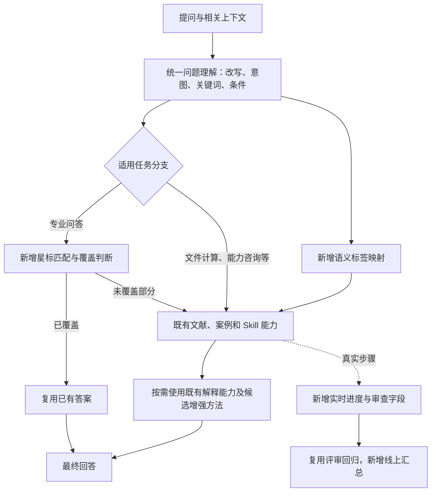

# 农业助手整体链路优化｜增量 PRD 总览

版本：V0.3｜日期：2026-10-17｜状态：审查修订，待开发验收

V0.3 补齐开发前审查 R01—R05；跨模块规则统一引用[运行、检索与审查契约](14_跨模块运行与审查契约.md)。本次是文档修订，不表示应用功能已实现或验收。

## 1. 本次修订说明

V0.1 把现有功能、历史需求和本轮建议展开写在了一起，容易被理解为重新建设。本版以增量为主：已有能力直接复用，历史 PRD 已定义的功能回原需求管理，只对本轮新增或确需改变的地方提出开发要求。

V0.2 针对范围纠正，沿用当时两份附件，没有因附件增加功能而扩项。V0.3 在此基础上修正案例容量基线，补齐提交幂等与恢复、正式 Run 审查、未打标条件核对及状态统计。原版保留为讨论与审查记录，后续按 V0.3 及共享契约推进。

## 2. 依据及使用方式

| 编号 | 依据 | 本版处理 |
| --- | --- | --- |
| B1 | 案例与措施 PRD V1.0、V1.1，最新日期 2026-10-16 | 既有管理、打标、批量操作、两种 Skill、简单路由与追问不重复立项 |
| B2 | 文献 PRD V1.0—V1.2.1，最新日期 2026-10-15 | 既有上传、解析、打标、批量任务、多级筛选及补丁回原需求 |
| B3 | 星标问题 V0.2，2026-10-15 | 管理与首批录入是原范围；本轮仅新增聊天衔接 |
| B4 | 工具、Skill、MCP 现状盘点，2026-10-16 | 识别源码已有实现、明确边界以及可复用工程能力 |
| B5 | 2026-10-17 开发前源码与契约审查、独立内存库容量复现 | 修正案例超限报错基线，明确恢复与正式 Run 审查的实际缺口；不是线上验收 |
| N | 本次整体链路讨论 | 统一问题理解、聊天匹配、可视化、实时进度、审查和指标等新增方向 |

“历史已定义”不等于每个细节均已部署验收；“盘点已有”也不等于当前线上已验证。本稿不会由旧 PRD 推断所有功能都已完成，也不会因未重新验收就把它们全部重新立项。旧项有缺陷时关联原需求处理。

## 3. 只列本轮变化的模块目录

| 模块 | 本轮增量 | 明确复用／移回历史需求 |
| --- | --- | --- |
| [M01 问题理解与上下文](01_问题理解与上下文_PRD.md) | 统一理解结果、Query 改写、条件来源、歧义与换题规则 | 已有案例和文件追问状态 |
| [M02 星标问答聊天匹配](02_星标问题管理与优先匹配_PRD.md) | 匹配、覆盖判断、部分复用、后续衔接 | 星标新增、编辑、查看和原首批录入 |
| [M03 文献与 RAG 衔接](03_文献管理与RAG衔接_PRD.md) | 检索状态、原件索引关联、同步与失效、统一查询输入 | 上传、解析打标、批量任务和现有 RAG |
| [M04 案例检索扩容](04_案例与措施管理及检索_PRD.md) | 全量候选可达、预算取材、统一输入和事件 | 案例管理、解释草稿、批量操作、已有组合和比较 |
| [M05 语义标签映射](05_共享标签与语义映射_PRD.md) | 问题概念映射已有标签、记录用途、处理歧义 | 标签体系、父子选择、未打标和 AI 建议 |
| [M06 路由编排衔接](06_路由与Skill编排_PRD.md) | 接入理解与星标分支、实时事件和审查关联 | Runtime、Registry、现有组合、Trace 和预算 |
| [M07 解释方法增强](07_通俗解释与外部能力_PRD.md) | 公开方法适配、同题对照、易懂性与证据边界检查 | 已有案例／文本解释和专业原文保护 |
| [M08 Skill 轻量展示](08_Skill可视化与有限配置_PRD.md) | 列表详情、只读说明、少量表达字段编辑 | 七项实际能力、Schema、登录及已有健康信息 |
| [M09 实时执行进度](09_前台执行进度展示_PRD.md) | 真实事件流、步骤状态、重试与恢复 | 已有简单路由概念和实际调用记录 |
| [M10 会话审查补充](10_后台会话审查_PRD.md) | 新链路信息、归因字段和线上会话关联 | 评审、队列、问题跟踪、回放与版本比较 |
| [M11 线上效果汇总](11_效果大盘与迭代验证_PRD.md) | 明确指标分母、抽样来源、归因到回归关联 | 现有 Harness、用例与版本化执行 |

配套：[能力基线与逐项差异](12_能力基线与逐项差异.md)、[评审决策与验收安排](13_评审决策与验收安排.md)、[跨模块运行与审查契约](14_跨模块运行与审查契约.md)。共享契约是相关模块开发时的共同依据，不是新增业务模块。

## 4. 目标链路

已有工具调用、原文事实、计算和访问约束继续由现有实现执行。新增前置理解与展示层不能绕过它们。

## 5. 需求分类规则

| 分类 | 在本版中的含义 | 排期方式 |
| --- | --- | --- |
| 既有能力 | 能力盘点已记录实现 | 复用，相关改动做回归 |
| 历史已定义 | 旧 PRD 已覆盖但本次未逐项验收 | 不重复立项，缺陷或未完项回原迭代 |
| 本轮新增 | 本次讨论提出、基线没有对应完整链路 | 单独评审估算 |
| 既有调整 | 保留原能力，仅改输入、接口、展示或范围 | 明确差异后估算 |
| 待确认建议 | 助手补充的默认值、技术或策略 | 不自动计入首期承诺 |
| 暂缓 | 本轮明确不做 | 不作为验收前置条件 |

## 6. 建议推进顺序

1. 按共享契约对齐身份、事件、状态和审查字段，只补真实缺口。
2. M08 只读展示可独立交付；M01 可先接既有路径，未接入服务标未采集。
3. M06 先补持久化受理、幂等、完整结果及事件恢复，再由 M09 接真实进度；无需等待全部检索模块。
4. 按实际瓶颈推进 M02、M03、M05。M04 先验证条数／字符超限造成的容量拒绝及召回问题，再定扩容方式。
5. M10 补正式 Run 直接审查和独立维度；M11 在具备身份、层级和有效审查数据后分阶段汇总。M07 仍先小范围对照试验。

这是依赖顺序建议，不表示 11 个模块必须同一期交付。每模块的“首期”是该模块的最小实现，不是对所有模块同时开工的要求。

## 7. 跨模块约束

- 原始问题、资料、人工答案和 AI 解释分别保留，不相互覆盖。
- M01 输出统一理解，M05 输出实际标签用途，下游避免重复推断出不同条件。
- 星标优先只对适用子任务生效；空答案或部分答案不阻断后续能力。
- 标签不完整不等于语义条件不满足；正文候选按满足／不满足／未知核对，冲突未解决不称严格匹配。资料访问资格始终严格执行。
- 不可用资料在返回新证据前再次校验，历史回答不被改写。
- 计划、真实调用、无结果、失败、跳过和取消明确区分。
- 前后台使用同一轮次、提交和运行关联；网络重发不新建运行，主动重跑关联原运行，默认主运行固定为首次已受理运行。
- 正式 Run 直接审查，相关性与充分性独立记录；工具、Skill 和父容器不混算，未开始或跳过不进执行分母。
- 内部 ID 用于定位，对公众以可读名称、来源和执行事实展示。
- 工具成功、引用通过、路由正确和专业回答合格分别判断。
- Skill 首期以展示和有限编辑为主，不开放路由、公式、权限或全部 Prompt。

## 8. 验收如何安排

各模块验收分为“本轮变化”与“既有功能回归”。回归要求不等于新增开发功能量。历史补丁不默认成为本轮发布阻塞，除非本轮改动确实影响该能力或双方重新确认范围。

重点联合场景：同义星标匹配、空答案后续、部分覆盖、多轮更正和换题、未打标资料、文献已登记未就绪、案例超过读取上限、停用／关闭、局部失败、Prompt 生效追溯、进度断线恢复、人工正确率分母。

## 9. 本轮暂缓

不新增完整资料管理平台、标签本体平台、评测平台、通用自主 Agent、拖拽流程、全参数 Prompt 平台或 MCP 管理台。回答文字流式与外部在线服务单独待定；已有解释方法和工具不被当作农业专业认证。

本文只修订产品文档，没有更改应用代码、安装外部 Skill 或接入服务。
