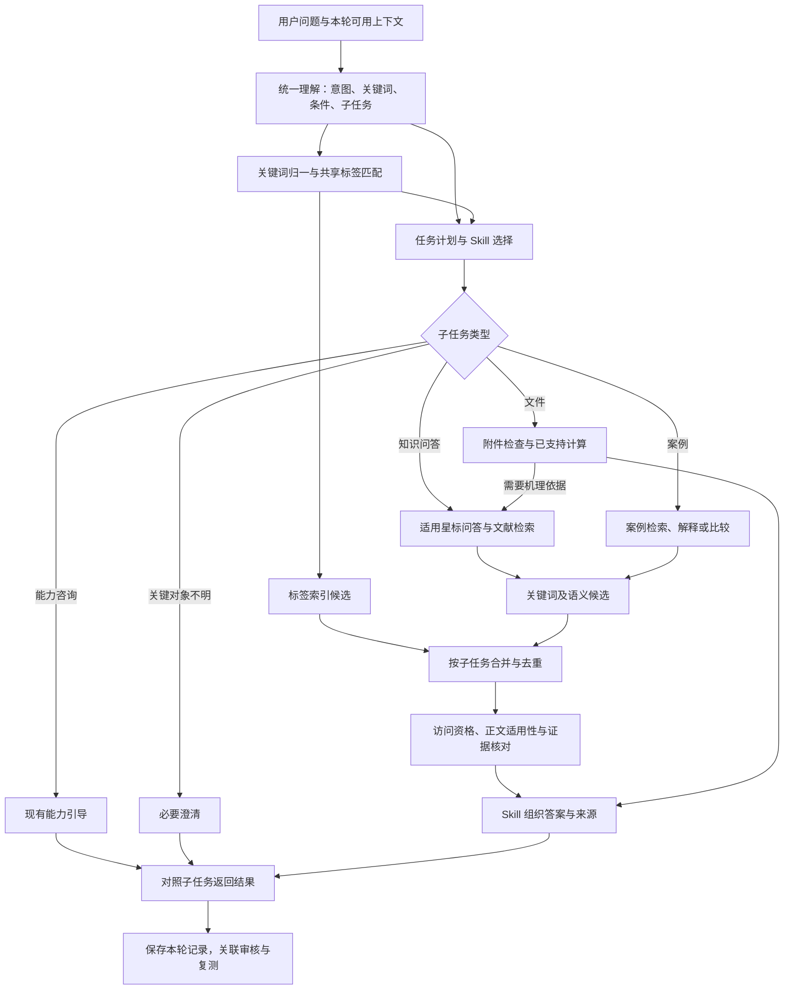

# 农业模型助手：检索与 Skill 链路改造 PRD

版本：V0.1｜2026-11-11｜状态：方案初稿，供本地开发评审

## 1. 方案结论

本轮围绕**统一问题理解、标签辅助召回、任务到 Skill 的匹配、证据核对与可复测记录**改造现有链路。

用户输入后，先明确“要做什么、关于什么、有什么条件”，再分别产生 Skill 候选和资料候选。以现有标签 ID 作为资料标识，建立关键词和标签的本地索引，让后续能力复用同一份理解结果。已有运行时、资料管理、七项 Skill、审核和复测入口继续使用。

首个可交付版本要跑通三条业务主线：

1. **专业问题：** 问题理解 → 适用星标问答／文献候选 → 证据核对 → 回答。
2. **案例问题：** 问题理解 → 相似案例 → 按实际对象解释或比较 → 回答。
3. **文件问题：** 问题理解 → 有效附件与指标确认 → 已支持计算 → 必要时补充文献机理。

标签匹配服务作为上述流程的共用前置能力，本期不新增第八个聊天 Skill。前台仍是自然对话，不要求用户先选择标签或确认每次改写。

## 2. 为什么要改

### 2.1 用户目标

用户希望在本地迭代服务器上的农业模型助手。系统已经有标签体系，希望从问题提取意图和关键词，初步匹配 Skill、标签及资料，提高检索速度和准确性。

### 2.2 本次核对事实及边界

| 来源 | 已确认事实 | 对方案的含义 |
|---|---|---|
| 2026-11-11 已登录线上标签页 | 5 个维度、101 个标签；按自身及祖先状态检查后 97 个可参与新匹配 | 复用稳定 ID 和原层级，先处理状态与歧义，不重建整套分类 |
| 同日线上 Skill 列表 | 7 项已注册能力，3 项 AI 能力显示依赖待验证 | 路由必须区分“已注册”和“本轮可执行” |
| 本地归档源码 a95b797 | 已有 understanding、map_tags、规则路由、星标匹配、资料检索、Trace 和组合执行 | 按缺口增量改造，不能把这些全部列为从零开发 |
| 归档 runtime 源码 | 统一理解及标签映射已有输出；初始路由仍调用 `decide(body.query, ...)` | 优先核对并统一路由输入，减少前后环节各自理解造成的偏差 |
| 归档检索源码 | 文献管理正文和案例路径仍有遍历候选、逐项计算词项分数的处理 | 需要索引与候选生成的改造，标签映射本身不足以证明已提速 |
| 11-09 已有审核整理 | 菜地 N₂O、WHCNS介绍、光合作用、能力介绍和新手追问等存在明确意见；另有已通过案例轨迹 | 用真实问题验证路由、资料召回和回答策略，保留正向回归 |

线上标签及 Skill 清单是本次读取；SSH 重连在登录前超时，源码证据来自此前归档，**尚未证明当前服务器逐文件一致**。11-09 审核材料是历史状态，也未在本轮重新执行。开发开始时先核对完整本地项目和当前线上版本。

历史 PRD 已定义问题理解、共享标签、Skill 编排和正文适用性规则；本稿将其围绕本次目标收敛成一份可实施增量方案，旧文档中的“待开发”不能直接当作当前缺失事实。

## 3. 目标与范围

### 3.1 产品目标

- **更容易问：** 短语、简称、相关追问能进入合理任务路径，只有影响执行的缺失才追问。
- **找得更准：** 关键词和同义表达能关联稳定标签；同名歧义、否定、比较对象和正文条件得到保留。
- **检索更快：** 先用索引生成有限候选，再做必要的召回合并与核对；减少常规请求对资料全池的重复扫描。
- **能看出原因：** 能定位本轮是理解、标签映射、Skill 选择、召回、证据核对还是回答环节出现问题。
- **能持续迭代：** 同一真实问题可以保留旧结果、验证新配置，不覆盖原审核事实。

### 3.2 首期包含

统一问题理解契约、受控同义词配置、现有标签匹配、Skill 选择适配、标签与资料倒排索引、原检索路径合并、证据适用性核对、现有运行详情增量、版本化复测、上线切换与降级。

### 3.3 后续单独安排

- 相关领域基础知识联网检索：历史审核已有此诉求，但不在当前七项 Skill 声明中；列入后续能力方案，不假定已接入。
- 大规模标签重构、地理知识图谱、自动合并或迁移全部旧标签。
- 通用表格分析、直接执行 WHCNS 仿真、自动校准与自动生成田块施肥方案。
- 全新后台、拖拽流程平台、无限 Agent 工具循环、跨会话长期记忆。

## 4. 总体业务链路

图中表示逻辑关系，不要求把现有检索实现全部从 Skill 中搬到独立总控服务。编排层统一下发任务上下文；检索适配层在实际需要时读取标签及内容索引。文件检查、计算、资料核对和生成只记录真实执行的步骤。

## 5. 核心设计：三类信息分开保存

| 信息 | 回答的问题 | 例子 | 用途 |
|---|---|---|---|
| 任务意图 | 用户要做什么 | 找案例、解释概念、比较材料、计算极值 | 选择 Skill 和步骤依赖 |
| 主题标签 | 用户在问什么 | 玉米、河北、氮淋溶、滴灌、WHCNS | 生成资料候选和辅助排序 |
| 条件及来源 | 哪些要求必须保留、来自哪里 | 排除玉米；只查河北；三个处理的合计 | 核对适用性、解释过滤和比较对象 |

一个问题允许多个意图、多个维度和多个对象。标签命中数不作为理解正确或答案完整的判断标准。

### 5.1 完整示例

用户：“找河北玉米滴灌的案例，比较一下灌溉方式对氮淋失的影响。”

| 环节 | 预期处理 |
|---|---|
| 理解 | 拆为“找案例”和“基于找到的材料比较”，第二项依赖第一项；保留作物、地区和主题要求 |
| 标签 | 河北 `T-127da46564e5`；玉米 `T-74ce41cce69c`；滴灌 `T-e1ba99099af1`；氮淋失可成为“氮淋溶”的受控候选映射 |
| Skill | 先 case_reference；有可比较对象及依据时再 case_explanation；材料不能比较时说明缺口 |
| 召回 | 同时查看标签、原词和正文候选；不能因有效滴灌标签目前直接关联 0 条案例就宣布无案例 |
| 核对 | 案例是否真的是河北玉米、有哪些灌溉方式、是否有氮淋失效果依据；不补造数值或因果 |
| 回答 | 给出能支持的案例和差异，区分“材料有此数据”和“目前无法比较”；返回实际来源 |

## 6. 详细功能需求

### F01 统一问题理解与上下文

**输入：** 原问题、本轮可访问附件、相关历史和此前实际展示的材料锚点。

**输出：** 原问题、补全问题、意图列表、原词／规范词、实体分类、条件与来源、子任务及依赖、检索 Query、未确定项、理解版本。

规则：

1. 本轮明确更正覆盖相关旧条件；无关条件不随意清空，也不把全部历史条件带入新话题。
2. 否定、数量、单位、时间和单次／合计口径必须保留。模型推断条件标明来源，不能升级成用户要求。
3. “它们”“那最小值”只能继承此前实际展示对象或已确认指标。上轮有三个案例，本轮说“这两个”且无法确认对象时才澄清。
4. “WHCNS模型”“氮素淋失”这类独立短语可先作基本介绍，不强制要求完整种植条件。
5. 所有后续任务使用同一理解快照及明确的子任务上下文。直接指定 Skill 的入口保留其指定状态，不混入自动路由评估。

**实施建议：** 先复用现有规则，受控词典处理确定表达；规则未覆盖的语义在实际样本证明需要后再引入有输出校验的模型辅助。不要为每个步骤新增一次模型调用。模型辅助无效或超时，回退原始 Query 和已确认上下文，记录降级。

### F02 关键词归一与标签匹配

**输入：** F01 关键词、条件来源、当前标签及别名配置版本。

**输出：** 原词、规范表达、候选标签 ID 和路径、匹配方式、唯一／歧义／未匹配状态、正向／排除、所属条件与对象、实际用途。

规则：

- 按完整路径／标签名称、已维护别名的顺序匹配。N₂O 等字符先作规范化；不同化学物质和过程不能只因字面相近而互换。
- 多候选不按名称覆盖；停用标签和停用祖先下的后代不参与新匹配。
- 未匹配词继续用于原词或语义检索，不自动创建标签。
- “硝态氮淋失”到更宽的“氮淋溶”标为相关主题候选；“氮损失”不直接等同为氮淋溶。
- 保留标签历史 ID 和关系；新配置不能改写历史运行中的标签快照。

匹配用途必须区分：

| 用途 | 示例 | 执行规则 |
|---|---|---|
| 排序辅助 | 模型推断、相关主题候选、未经核对的 AI 标签 | 影响候选和排序，不作为排除正文候选的唯一依据 |
| 语义条件 | “找河北玉米案例” | 保留地区与作物要求，核对正文适用性；缺标签不等于不满足 |
| 显式标签筛选 | “只查打了玉米标签的记录” | 按指定标签成员关系筛选；无结果也不静默撤销限制 |

### F03 意图到 Skill 的初步匹配与执行计划

| 任务 | 目标 Skill／步骤 | 触发和边界 |
|---|---|---|
| 能力咨询 | capability_guidance | 直接说明已开放能力和限制 |
| 概念、规律、机理及文献问答 | 适用星标前置服务 → knowledge_search | 星标完整覆盖可直接返回；部分覆盖只处理未覆盖子任务 |
| 找案例与措施 | case_reference | 访问符合资格的案例候选，不强制先问完整田块条件 |
| 解释指定案例或粘贴文本 | case_explanation | 先确认对象，用户文本无需先存入资料库 |
| 找案例后比较 | case_reference → case_explanation | 有完整且可确认的比较对象才执行后一步 |
| 已支持结果表极值 | file_inspector → whcns_analyzer | 文件、字段、统计方式满足现有输入范围 |
| 极值与可能机理 | 上述计算 → knowledge_search | 数值事实与一般可能机理分开 |
| 必要信息缺失 | clarification | 仅追问阻碍当前任务的内容 |

以“任务 + 输入对象 + 依赖可用性”选择 Skill；出现 WHCNS 标签本身不触发表格计算。“比较”不能单独决定 Skill，还要看对象是案例、文献还是文件。

路由结果记录候选、采用能力、原因和版本。候选不是已经调用；计划与实际调用分开。纯能力咨询无需先走所有检索环节。依赖不可用时明确说明该分支状态，保留其他已完成结果，不承诺指定 Skill 已执行成功。

### F04 标签及内容索引

建立并在本地维护以下关系，优先使用现有持久化和检索设施：

| 索引／关系 | 内容 | 用途 |
|---|---|---|
| 规范表达 → 标签 ID 列表 | 名称、路径、受控别名及其状态 | 抽取结果快速初步匹配 |
| 标签 ID → 后代标签 ID | 仅有效分支 | 父标签展开、状态继承 |
| 标签 ID → 资料 ID | 分别记录文献和案例 | 标签快速产生资料候选 |
| 文献 ID → 片段与内容版本 | 原件、正文及检索索引映射 | 按文章定位分片、去重和证据追溯 |
| 资料 ID → 当前访问／使用／同步状态 | 沿用已有状态来源 | 防止失效内容进入新答案 |

名称及标签映射可缓存，按版本刷新；资料访问资格不能只信任旧缓存。新标签索引可使用独立版本，构建失败期间继续原检索路径。

**更新行为：**

- 只改标签、名称或关系时，更新受影响倒排及元数据，不无故重做全部向量化。
- 正文或原件变化时，更新对应内容版本及必要索引；旧同步任务不得覆盖新版本。
- 停用、删除或权限变化立即影响新请求资格。物理索引清理滞后时，采用证据前仍按当前状态排除。
- 重建索引可重复执行；完成校验后切换，不暴露半构建索引。

索引具体存储、分词及检索引擎在完整项目核对后选型；首期不以更换技术栈作为交付前提。

### F05 多路召回、合并与排序

针对每个子任务和比较对象分别生成检索请求：

1. 核对资料范围、会话归属和可用状态。
2. 按任务类型并行或按需读取标签候选、原词／全文候选、现有语义候选；现有星标匹配作为知识路径的适用前置服务。
3. 在保留未打标资料入口的前提下合并候选，按资料及内容版本去重。
4. 核对用户条件与实际正文，将满足、不满足、未知和冲突分开。
5. 对符合任务的候选排序并按现有材料预算采用，记录各路贡献、未采用原因和回退路径。

初始排序以实际相关正文为基础，唯一且适用的标签可加辅助权重；全文与向量分数不直接裸加。可在现有设施中选择统一排序或基于各路名次的融合方式，保持配置可调整、版本可追溯。具体权重、TopK 和阈值由基线样本确定，不预设未经测量的置信概率。

常规候选足够时不无条件扫描全部正文；候选不足时保留扩展检索与原路径。候选预算造成未全面检索时，不能把“未找到”直接说成“库中不存在”。

**比较场景：** “肇东与清徐比较”建立两个对象组，各自召回和核对；“同维度 OR、跨维度 AND”可用于明确标签筛选，不可机械地要求同一材料同时属于两地。

### F06 证据核对与最终回答

- 无标签但正文明确符合用户条件的资料可采用；标签不能成为唯一入口。
- 正文可靠地不满足条件时，不能因标签相近而改判为满足。
- 标签与正文冲突保留核对依据；未解决不称严格匹配。仅有标签或模型推断不能独立证明适用。
- 条件未知资料可保留为待核对候选；如向用户另列一般参考，应明确范围，不能冒充满足硬条件。
- 正常检索无结果、检索失败、资料不支持结论是不同结果，应分别表达。
- 回答对照子任务覆盖情况：完整、部分、待补充或未完成。计算完成而机理分支失败时保留计算及证据。
- 每项结论关联实际资料片段、案例、附件单元格或维护问答；页码不可得时保留真实定位，不编造页码。
- 简单术语先直接解释；不强制套长报告。解释表达不能改变原数字、单位、处理条件或用量口径。

### F07 运行记录、页面与迭代

**前台：** 继续使用当前聊天与来源展示。按实际步骤简要显示理解、查资料、检查文件或组织回答，不显示内部标签 ID、规则 JSON 或未经验证的置信度。必要澄清在对话中进行。

**现有后台会话详情：** 逐步补齐以下信息；已有字段直接复用，默认展开摘要，明细折叠：

| 区域 | 最小内容 |
|---|---|
| 问题理解 | 原问题、补全问题、意图、关键词、条件来源、子任务与对象 |
| 标签匹配 | 原词、标签路径与 ID、方法、歧义、用途、未匹配词 |
| 执行 | 计划及实际 Skill、依赖状态、未执行原因、分支结果 |
| 检索与证据 | 各路候选、采用项、过滤与冲突依据、原文定位 |
| 本轮版本和耗时 | 理解、词典、标签、路由、索引、Prompt、模型；各阶段及总耗时 |

**复测：** 沿用“标记问题 → 调整资料／配置 → 原问题验证 → 人工核对”的主路径。重跑固定原问题及必要上下文，保留旧运行和审核结果，产生新运行并关联比较。现有同题 Prompt 对照可用于表达问题；标签和路由问题必须通过正常端到端入口验证。

不新增需要维护第二份数据的“大而全”后台。别名首期用版本化本地配置，后台只展示实际采用及错误归因；需求稳定后再评估编辑界面。

## 7. 关键数据契约

按现有字段适配，不要求新建一套平行数据库。

| 对象 | 最小字段 |
|---|---|
| 本轮理解 | turn_id、run_id、raw_query、resolved_query、intents、concepts、conditions、subtasks、unresolved、version |
| 条件 | condition_id、值与单位、正向／否定、来源轮次、是否用户必须条件、object_group |
| 子任务 | subtask_id、任务意图、输入对象、依赖、关联条件、检索 Query |
| 标签映射 | 原词、规范词、候选 ID／路径、状态、方法、用途、条件与子任务关联、标签及别名版本 |
| 执行计划 | 子任务、候选及采用 Skill、原因、必要输入、可用性、真实执行结果 |
| 候选与证据 | 资料 ID、类型、内容版本、召回路径、名次／分数、条件判定、原文位置、是否采用及原因 |

原则：同一运行固定配置快照，资料采用时另查实时可用性。历史未采集的字段显示未知，不用当前配置补写历史事实。复用既有提交、运行和恢复规则；本轮不改变网络重发的幂等含义，不因查看或复测页面重复执行原工具。

当前提供的 `taxonomy.json` 使用本地 dimension_key，线上原始维度 ID 未从页面采集。开发接入真实库时应读正式维度 ID；不能把 crop、region 等本地键当成线上主键。

## 8. 数据整理与迁移安排

| 发现 | 首期处理 | 后续处理 |
|---|---|---|
| 旧作物“已废弃” `T-067d23c4868a` 仍关联80篇文献、4条案例 | 保留快照；从新标签匹配排除；正文召回继续覆盖合格资料 | 逐项核对是否应迁到新玉米标签，记录迁移前后关系及重叠 |
| 新玉米 `T-74ce41cce69c` 显示24篇文献、0条案例 | 保留原ID及层级，不据此判断无玉米案例 | 核对打标覆盖和遗漏 |
| 两个“陕西”标签 | 一般语义保留双候选并核对正文；显式指定路径时精确匹配 | 评估地理概念与分类路径是否需要拆开管理 |
| “桂平”“南宁”位于停用地区分支 | 排除新匹配，保留历史关系 | 核对是否移动到有效分支 |
| 活跃标签的案例直接关联数均为0 | 案例正文路径必须保留 | 梳理案例打标与有效标签覆盖 |

关联数不能跨标签直接相加，也不能说明资料开放或全文就绪。首期不自动批量改线上标签，不删除旧关联。正式迁移另生成可审阅差异表，在备份、引用校验和回退方案具备后执行。

## 9. 异常与降级

| 情况 | 预期行为 |
|---|---|
| 理解失败或不合法 | 保留原问题和已确认上下文，进入现有明确规则路径；不继承不确定对象 |
| 标签服务／词典失败 | 原词、全文和语义路径继续；记录标签降级 |
| 标签索引版本落后 | 可用资格实时复核，回退已验证索引或原检索；不把旧状态当当前状态 |
| 歧义仅影响辅助排序 | 保留候选，不无谓追问；影响显式筛选或执行对象时才澄清 |
| 某路检索超时或无结果 | 保留其他路结果及状态，说明未完成部分；不掩盖用户硬条件 |
| Skill 必要依赖不可用 | 不伪造调用成功；保留其他分支结果并说明当前能力限制 |
| 资料生成期间被停用或内容变化 | 证据采用前复核，按现有异常规则重取合格证据或结束该分支 |
| 取消、预算不足或执行中断 | 记录真实终态、已完成结果和未执行任务，不能统一记为业务完成 |

## 10. 验收场景

以下是本轮行为验收夹具，不是全部已有功能的新增开发清单。对已有通过行为作保护，对未通过项补实现。

| 编号 | 场景 | 可观察验收点 |
|---|---|---|
| A01 | 玉米农田氮淋失主要受哪些因素影响 | 保留作物与主题，路由知识问答；文献引用实际相关正文 |
| A02 | 菜地 N₂O 排放规律／氧化亚氮排放 | 术语规范化可追踪；同一主题的表达变体不会因名称差异完全丢失候选 |
| A03 | WHCNS模型／WHCNS模型是什么 | 先作基本介绍；不因模型标签转入附件极值计算 |
| A04 | 有没有玉米滴灌案例 | 找案例；标签直接关联为0时仍检索合格正文候选 |
| A05 | 上轮两个案例后问“它们追肥有什么区别” | 对象与此前实际展示案例一致，保存锚点 |
| A06 | 上轮三个案例后说“比较这两个” | 对象无法确认时简短澄清，不任取两个 |
| A07 | 从玉米更正为番茄，或明确换话题 | 只替换相关条件；无关旧范围不残留 |
| A08 | 排除玉米，找小麦研究 | 否定关系进入理解、映射和证据核对；不将玉米当正向目标 |
| A09 | 找陕西案例 | 保留两个原标签ID；按语义合并核对候选，不由字典覆盖丢弃一个分支 |
| A10 | 只查“西北 / 陕西”标签记录 | 精确执行显式标签成员筛选；无结果不静默扩大 |
| A11 | 两地区或两作物比较 | 按对象分别召回和核对，不要求单材料同时符合所有对象 |
| A12 | 无标签但正文明确符合 | 能进入候选并被核对采用；实际召回路径可查 |
| A13 | 标签与正文冲突／条件未知 | 不冒充严格匹配，记录冲突或未知及依据 |
| A14 | 自身启用但父标签停用 | 不参与新标签匹配，历史关系可追溯 |
| A15 | 附件极值及“那最小值呢” | 仅在有效附件、字段和支持范围内计算，正确继承指标与原件证据 |
| A16 | 极值成功、文献机理失败 | 保留数值和位置，标明机理未完成及部分结果 |
| A17 | 新建、改标、停用、删除、正文更新后再检索 | 倒排和内容版本行为一致；旧任务不覆盖新状态，失效资料不进入新证据 |
| A18 | 标签或某路索引故障 | 原检索可运行，降级可追踪；资料访问条件继续执行 |
| A19 | 原问题验证、重跑与历史查看 | 旧答案和审核保留；新运行关联旧轮次；查看不重复调用工具 |
| A20 | 你能做什么 | 能力说明与实际开放范围一致，不承诺仿真或通用Excel分析 |

历史“解释光合作用”的联网诉求单独跟踪：首期正确说明实际知识来源和当前能力，不把未接入的外部检索计为完成。它将在后续联网检索能力验收时成为专项用例。

## 11. 效果评估及口径

先建立可复测基线，再讨论提升目标。开发样本和保留验证样本分开；同题改写可做鲁棒性检查，不冒充独立专业核验样本。

| 指标 | 定义及适用范围 |
|---|---|
| 意图／任务匹配 | 人工确认的任务集合与本轮识别结果比较；复合题同时检查遗漏及误加任务 |
| 自动路由正确率 | 自动模式中实际采用的Skill组合符合预期的可判定题数／可判定自动模式题数；指定模式另列 |
| 标签匹配质量 | 逐原词检查ID候选、歧义、用途和否定；有效ID不等于语义正确 |
| Recall@K | 对已人工确认相关材料集合的题，前K候选覆盖的相关材料数／已知相关材料数；标注覆盖不足时说明局限 |
| Precision@K | 前K候选中人工判相关的材料数／实际返回的候选数；空结果单列 |
| 错误排除与证据适用性 | 检查符合条件材料是否因缺标签被排除，采用证据是否真实满足用户条件 |
| 检索耗时 | 区分关键词匹配、候选召回、核对／排序及完整检索的p50/p95，记录冷／热缓存 |
| 端到端耗时和调用成本 | 同一问题从受理至完整结果，分别记录模型调用、工具和检索耗时，不把匹配微测当整体提速 |
| 降级与观测覆盖 | 标签故障、索引版本、回退原因、缺失字段和未知状态分别记录 |

固定模型、Prompt、资料与配置版本，使用同一批问题对比。历史已整理的8条会话可作首批业务回归：5条需修改用于定位，3条已通过用于保护；多轮会话按完整上下文复测，不能把旧失败回答当标准答案。专业正确性评价引用原审核意见和已确认资料，不用调用成功率替代。

**首期放行条件：**

1. A01—A20中适用的确定性流程检查通过，既有正向多轮与文件回归无新增阻断问题。
2. 未打标资料入口、否定、更正、对象分组及实时可用性规则具备可查证结果。
3. 有基线／新方案的相同版本对照记录。性能预算在基线测量后填写；没有样本前不承诺“提升某百分比”。
4. 新索引和路由可以独立切回已验证版本，原运行与证据记录不被覆盖。
5. 未具备专业依据的题保留待核验状态，不用于宣布系统整体专业准确率达标。

## 12. 分期交付与依赖

| 阶段 | 交付 | 完成标准 |
|---|---|---|
| P0 基线与契约对齐 | 核对完整本地项目和线上版本；冻结标签、别名、资料范围、真实问题及当前输出；逐项标已有／待改／待核验 | 有可重放基线、字段映射和增量差异表；不重复开发已有模块 |
| P1 首期闭环 | 统一理解驱动路由；受控标签映射；标签与资料索引；合并原检索路径；证据核对；现有运行详情补齐；失败可降级 | 三条主业务路径能通过正常入口复测，A01—A20适用检查及历史保护回归通过 |
| P2 调优与资料治理 | 根据失败归因调整词典、路由、排序和候选预算；核对旧标签关联迁移；同题对照与保留集验证 | 有可解释的质量和耗时改善记录，迁移差异逐项可审阅 |
| P3 能力扩展 | 单独设计相关领域基础知识外部检索及来源使用规则；必要时完善别名编辑界面 | 按新增能力专项验收，不影响既有本地证据和Skill边界 |

问题理解与执行契约先于路由改造；标签状态及映射规则先于倒排索引接入；候选合并、证据核对和可观测记录随主线一起交付。**P1包含完整证据返回闭环，不能仅完成标签命中就宣布首期完成。**

排期在P0确认真实缺口、开发资源和部署方式后估算。本稿不把历史PRD每个条目都重新计入工作量。

## 13. 本地开发及切换方式

1. 在完整本地项目中接入本次快照和匹配配置，保护当前线上数据。
2. 将新理解／路由适配、新标签索引和新召回融合设为可独立切换的策略版本，默认范围由复测结果决定。
3. 同题对照可先只比较理解和候选，不执行第二次对客任务或重复文件操作；确需完整复测时创建关联的新运行。
4. 标签字典、倒排索引与正文内容版本完成一致性检查后再扩大流量；持续检查未打标资料召回与失效资料排除。
5. 需要回退时切回已验证策略或索引版本，保留新旧运行；数据迁移采用单独备份及反向差异，不回灌旧库覆盖新增内容。

当前迭代包的匹配器仅演示上游提取结果到标签／Skill候选的接口，无自动意图抽取、全文检索、资料迁移或线上执行功能。

## 14. 待评审决策与默认建议

| 决策 | 本稿默认建议 | 何时确认 |
|---|---|---|
| 首期主范围 | 现有本地知识、案例、支持文件的整链路闭环；外部知识单列后续 | 开发评审 |
| 理解方式 | 规则及受控配置优先；真实歧义证明需要时再增加模型辅助 | P0真实问题分析 |
| 同义词维护 | 首期本地版本化配置；新建议有待审核状态，不自动扩大硬筛选 | P1接入前 |
| 两个陕西与旧玉米标签 | 保留ID，先保障召回；迁移逐项核对 | P2数据治理 |
| 性能目标、TopK和预算 | 冻结基线后设定；避免凭空指定分数或置信阈值 | P0结束 |
| 数据与专业验收 | 复用现有审核意见和已确认材料；补齐资料缺口及独立验证样本 | 首轮业务复测 |

## 15. 依据与配套文件

- [本次标签及Skill迭代包说明](标签与Skill本地迭代包/README.md)
- [线上标签快照](标签与Skill本地迭代包/taxonomy.json)、[人工查看全表](标签与Skill本地迭代包/标签全表.md)
- [Skill清单及证据来源](标签与Skill本地迭代包/skills.json)
- [归档代码来源与哈希](标签与Skill本地迭代包/原实现参考/来源说明.json)
- [共享标签与语义映射历史PRD](标签与Skill本地迭代包/原实现参考/docs/iterations/2026-10-17-prd-review/revised-prd/05_共享标签与语义映射_PRD.md)
- 线上核对入口：[标签管理](https://www.nitrogen-leaching.com/evaluation/literature-tags)、[Skill能力](https://www.nitrogen-leaching.com/evaluation/skills)。

历史问题理解、Skill编排及跨模块契约已阅读，关键兼容规则已纳入本稿；所有“新增／优化”均是本期目标，不表示现已实现或通过线上验收。
